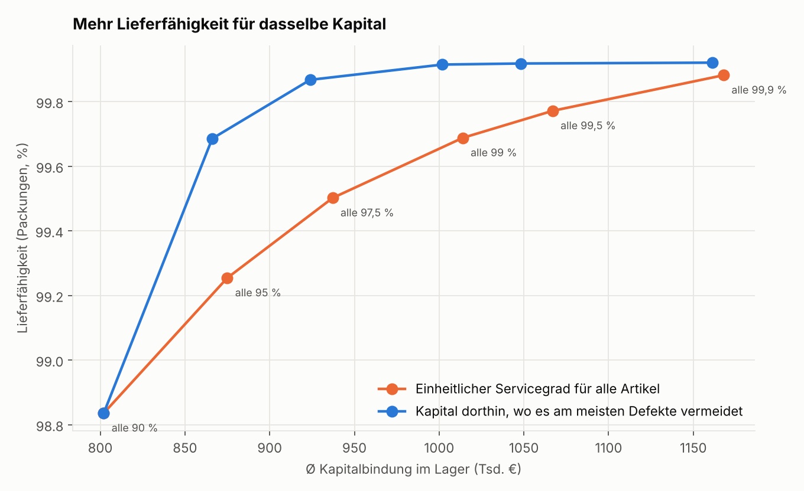
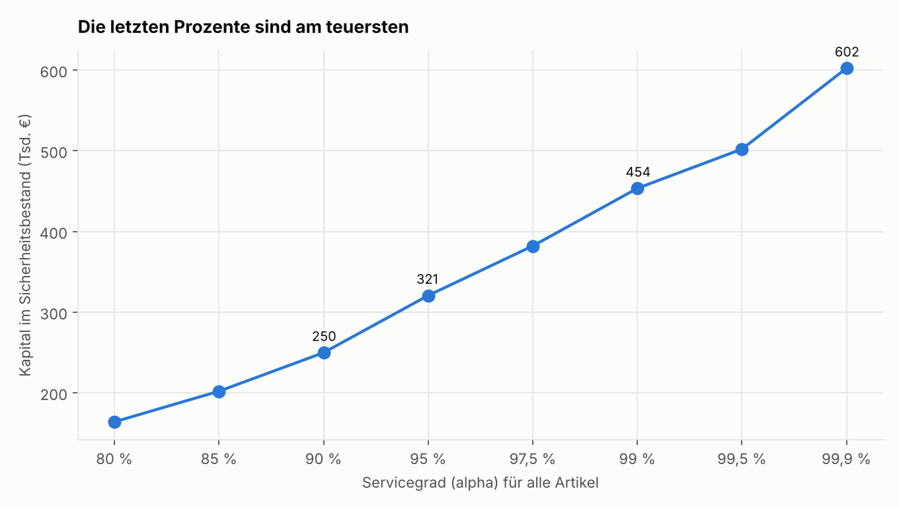
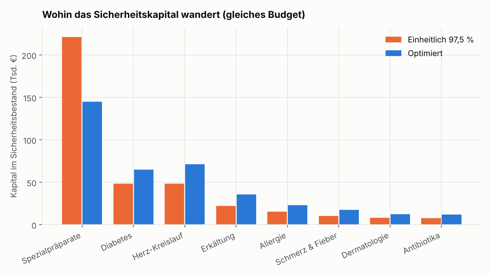
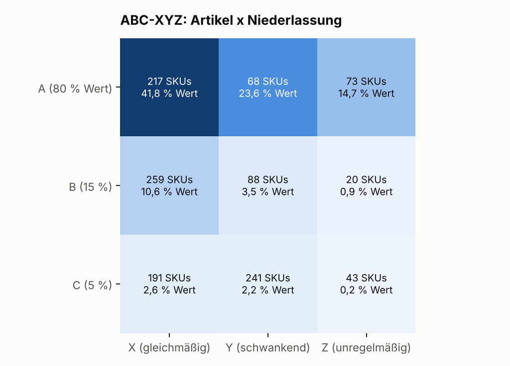
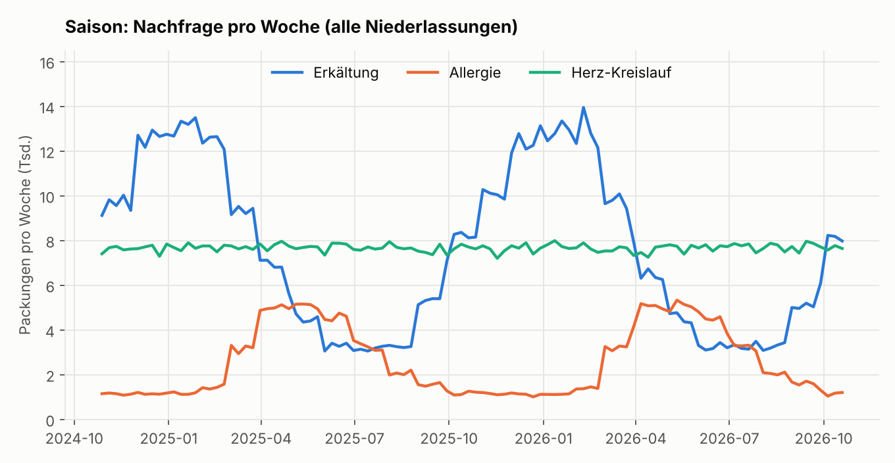

# Inventory optimisation: service level vs. working capital

[Deutsche Version](README.de.md)

A pharmaceutical wholesaler has to deliver almost every medicine immediately – otherwise the pharmacy orders from a
competitor. At the same time, every pack in the warehouse ties up capital. This small model uses **synthetic data**
to show how this trade-off can be managed with numbers:

1. **ABC-XYZ**: which items carry most of the value, which are ordered steadily or erratically?
2. **Safety stock and reorder point** per item and branch.
3. **What does each percent of service level cost?** And does the same capital buy a higher service level when it
   is allocated deliberately instead of giving every item the same target?

> **All data is synthetic.** It is generated to show typical patterns (seasonality, weekdays, expensive specialty
> drugs, several branches). No company data is included.

## Results in three sentences

- **Same capital, fewer stock-outs:** allocating the safety-stock budget deliberately instead of "all items 97.5 %"
  raises the fill rate from 99.50 % to 99.87 % and cuts the share of order lines with a stock-out from 0.75 % to
  0.24 % (**−69 %**).
- **Or: same service level, less capital:** with only the budget of "all items 95 %", the targeted allocation
  reaches a 99.69 % fill rate – above the reference – with **7.6 % less** capital tied up.
- **The last percent is the most expensive:** safety-stock capital rises from €321k (95 %) to €454k (99 %) and
  €602k (99.9 %). The last 0.9 percentage points (99 → 99.9 %) cost more than the four before them (95 → 99 %).





## The trade-off the model makes visible



With a uniform service level, **58 % of the safety-stock capital sits in specialty drugs**, although they account for
only about 0.3 % of packs. The optimisation moves capital to fast movers – and the fill rate of specialty drugs drops
from 98.2 % to 96.7 %.

This is **a controlling decision, not just a technical one**: the model counts every pack equally. In practice one
would set a higher minimum service level for critical or expensive items, weight by gross margin, or hold these items
centrally in one branch.

## ABC-XYZ and seasonality





## How the model works

| Step | What happens | File |
|---|---|---|
| Data | 400 items × 3 branches = 1,200 SKUs, 2 years, Monday to Saturday. Demand with seasonality (colds in winter, allergies in spring), weekday effects and noise (gamma-Poisson). Supplier lead time 1–6 working days. | `src/data.py` |
| ABC-XYZ | A/B/C by annual value (80 % / 95 %), X/Y/Z by coefficient of variation of weekly demand (≤ 0.5 / ≤ 1.0). | `src/classify.py` |
| Safety stock | SS = z × σ<sub>day</sub> × √lead time; reorder point = lead-time demand + SS; order quantity = one week of demand. | `src/policy.py` |
| Allocation | Start with every item at 90 % (minimum supply). Each additional euro then goes where it avoids the most expected shortage (greedy, using the normal loss function) until the budget is spent. | `src/policy.py` |
| Simulation | Year 1 is used for learning, year 2 is simulated day by day: rolling demand and variability (28 / 56 days), reorder when the reorder point is reached, stock-out = pharmacy orders elsewhere (lost sale). | `src/simulate.py` |

**Metrics:** *fill rate* = delivered / demanded packs. *Order lines with stock-out* = share of item-days with demand
where not everything could be delivered. *Capital tied up* = average stock × purchase price.

## Limitations (on purpose)

- **Normal approximation:** inaccurate for items with very intermittent demand; Croston or an empirical
  distribution would be better there.
- **No public holidays, supplier shortages, rebate-contract switches or expiry.**
- **Censored demand:** in real data a stock-out hides demand in the sales figures, so one would use orders
  including stock-outs.
- **Weighting:** every pack counts the same. Weighting by margin or medical criticality changes the allocation
  (see specialty drugs).
- **Forecast:** only a moving average. A better forecast lowers σ and therefore directly lowers safety stock – the
  next lever.

## Run

```bash
pip install -r requirements.txt
python run_analysis.py   # about 1 minute, writes everything to results/
pytest -v
ruff check .
```

## License

MIT
